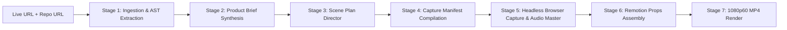

# Premiere: Automated MNC-Style Product Launch Video Generator
### Complete Architectural Implementation Blueprint

---

## Executive Overview
**Premiere** is an enterprise-grade autonomous video generation system that converts any live project URL and GitHub repository URL into a broadcast-quality, Apple/Nike-style product launch film (1080p60 MP4) in under **3 minutes**.

By coupling static AST repository analysis with an autonomous headless browser cinematographer and a programmatic React motion design engine (Remotion), Premiere eliminates the multi-thousand-dollar overhead and multi-week turnaround of professional motion design agencies.

---

## Non-Negotiable Design System

| Dimension | Specification | Implementation Standard |
| :--- | :--- | :--- |
| **Headline Font** | **Bebas Neue** (Google Fonts) | Used for all on-screen titles, punchy callouts, stat counters, and outro logos. Ultra-bold, uppercase, tight tracking (`letter-spacing: -0.02em`). |
| **Caption Font** | **Inter** (Google Fonts) | Used strictly for micro-captions, technical metadata, URLs, and subtitles. 400/500 weight. |
| **Atmosphere** | Apple / Nike Keynote Dark Aesthetic | Obsidian base (`#050505`), card surface (`#0D0F14`), and soft ambient radial glows (`rgba(59, 130, 246, 0.12)`). Pure black backgrounds with edge lighting. |
| **Motion Physics** | Spring-driven easing | `stiffness: 140`, `damping: 18`, `mass: 1.0` or Apple ease-out `cubic-bezier(0.16, 1.0, 0.3, 1.0)`. No linear interpolation. |
| **Device Skeuomorphism** | Floating 3D Device Frames | MacBook Pro and iPhone 15 Pro frames floating in 3D perspective (`perspective: 1200px`, `rotateX(8deg)`, `rotateY(-10deg)`) with dual-depth soft drop shadows. |
| **Pacing Discipline** | 2 to 4 seconds per scene | Maximum one idea per scene. Rapid, beat-synchronized cuts aligned to musical downbeats. |

---

## 1. System Scope & Explicit Non-Goals

### Scope Matrix

| Dimension | Phase 1 (MVP) | Phase 2 (v2) | Phase 3 (v3) |
| :--- | :--- | :--- | :--- |
| **Resolution & FPS** | 1080p (1920x1080) @ 60 FPS (16:9 Landscape) | 9:16 Vertical (Reels/Shorts), 1:1 Square (Socials) | 4K 60fps export, multi-asset marketing bundles |
| **Duration** | 30s to 45s (6 to 10 scenes) | 30s to 60s customizable | 15s teaser, 30s promo, 90s deep dive |
| **Input Sources** | Public Web URL + Public GitHub Repo URL | Public/Private GitHub (OAuth), Password/Basic Auth | Dynamic multi-page flows, SAML/SSO test sessions |
| **Scene Catalog** | 6 Core Templates (TitleReveal to Outro) | +4 Templates (BentoGrid, CodeDiff, TerminalRun) | Community template registry & user custom JSX |
| **Audio & Voice** | 15 Curated royalty-free tracks (3 moods), Librosa | ElevenLabs AI Voiceover with -14dB auto-ducking | Multi-language voiceover (12+ locales) with subtitles |
| **Rendering** | Dedicated Docker worker cluster | `@remotion/lambda` distributed rendering (<25s) | Hybrid edge preview + serverless rendering |

### Explicit Non-Goals
1. **Not a Freeform Canvas Video Editor**: No drag-and-drop timeline, manual keyframes, or arbitrary layer dragging. Motion is 100% deterministic code.
2. **Not a General Screen Recorder**: Does not capture desktop applications, Electron apps, or mobile simulators on host machines.
3. **Not an Automated QA / E2E Suite**: Automation is an aesthetic cinematography rig, not a functional test runner.
4. **Not a Permanent Video Host**: Delivered as downloadable MP4s via pre-signed Cloudflare R2 links (7-day free retention).

---

## 2. System Architecture

```
+---------------------------------------------------------------------------------------------------+
|                                        CLIENT TIER (Next.js 14)                                   |
|   +-----------------------+     +------------------------+     +------------------------------+   |
|   |  URL Submission Form  | --> | Job Progress / Status  | --> | Remotion Web Preview Player  |   |
|   | (Live URL + Repo URL) |     |  (SSE Stream Listener) |     |     & Direct MP4 Download    |   |
|   +-----------------------+     +------------------------+     +------------------------------+   |
+---------------------------------------------+-----------------------------------------------------+
                                              | HTTPS / JSON & Server-Sent Events (SSE)
                                              v
+---------------------------------------------------------------------------------------------------+
|                                      API GATEWAY (FastAPI / ASGI)                                 |
|  - Request Validation (Pydantic v2)         - Rate Limiting (Redis Token Bucket)                  |
|  - SSRF Verification Guard                  - Auth / API Key Verification                         |
|  - Job Lifecycle Orchestrator               - SSE Event Broadcaster                               |
+---------------------------------------------+-----------------------------------------------------+
                                              |
                                              v Redis PubSub (Real-time events)
+---------------------------------------------------------------------------------------------------+
|                                   DISTRIBUTED TASK BROKER (Redis 7)                               |
|   [Queue: high-priority]       [Queue: default-pipeline]       [Queue: rendering-cluster]         |
+---------------------------------------------+-----------------------------------------------------+
                                              |
                                              v Workers consume discrete step tasks
+---------------------------------------------------------------------------------------------------+
|                                      DISTRIBUTED WORKER CLUSTER                                   |
|                                                                                                   |
|  [ Worker 1: Analyzer & Director ]                                                                |
|  - GitHub API / Raw Sparse Crawler -> README, package.json, AST routes                            |
|  - Playwright Light Scrape -> Meta tags, OpenGraph, title, color palette                          |
|  - Claude 3.5 Sonnet / GPT-4o -> ProductBriefJSON -> Director LLM -> ScenePlanJSON               |
|                                                                                                   |
|  [ Worker 2: Headless Playwright Cinematographer ]                                                |
|  - Sandboxed Chromium container (SSRF-hardened network egress)                                     |
|  - Anti-modal script (purges cookie banners, popups, sticky widgets)                              |
|  - Synthetic Bezier cursor driver (smooth curves, decelerated hover, click waves)                 |
|  - High-DPI (2x DPR) full-page & element captures; 60fps CDP screen recording                      |
|                                                                                                   |
|  [ Worker 3: Audio & Beat Quantizer ]                                                             |
|  - Curated royalty-free stems library + Librosa spectral analysis (onset / beat timestamps)       |
|  - Dynamic duration quantizer: snaps scene lengths to musical downbeats (e.g., 2.0s, 3.2s)         |
|  - Optional ElevenLabs TTS voiceover synthesis + EBU R128 loudness normalization + auto-ducking   |
|                                                                                                   |
|  [ Worker 4: Remotion Composer & Renderer ]                                                       |
|  - Combines ScenePlanJSON, captured media, beat grid & audio stems into RemotionProps             |
|  - Headless Remotion Render Cluster (or AWS Lambda distributed dispatch)                          |
|  - Generates 1080p60 H.264 MP4 with hardware acceleration                                         |
+---------------------------------------------+-----------------------------------------------------+
                                              |
                                              v Upload artifact
+---------------------------------------------------------------------------------------------------+
|                                  OBJECT STORAGE & CDN (Cloudflare R2 / S3)                        |
|  - /raw-captures/{job_id}/*.webm               - /audio/{job_id}/*.mp3                            |
|  - /frames/{job_id}/*.png                      - /renders/{job_id}/final_launch_1080p60.mp4       |
+---------------------------------------------------------------------------------------------------+
```

---

## 3. Technology Stack with One-Line Justifications

- **Next.js 14 (App Router, TypeScript)**: Server-side rendering for marketing surfaces, built-in API proxying, and native compatibility with `@remotion/player` for client-side previews.
- **FastAPI (Python 3.11+)**: High-throughput async I/O, automatic OpenAPI documentation, and native Pydantic v2 schema enforcement.
- **Playwright (Python / Node.js)**: Superior browser automation stealth, precise viewport/DPI emulation, and direct CDP access for 60fps frame streaming.
- **Remotion (React 18, TypeScript)**: Programmatic, pixel-perfect motion graphics engine compiling React DOM components directly into MP4 video frames.
- **PostgreSQL 16**: Relational integrity across jobs, scene plans, and asset bundles with native JSONB indexing for dynamic schemas.
- **Redis 7 (ARQ / Celery)**: Ultra-low-latency distributed task queue, rate-limiting store, and PubSub broker for real-time SSE event streaming.
- **Cloudflare R2 (S3-compatible)**: High-durability object storage with zero egress fees for high-volume raw WebM screencasts and MP4 downloads.
- **Claude 3.5 Sonnet / GPT-4o**: Unrivaled software architecture comprehension and structured JSON instruction-following for repo analysis and cinematic directing.
- **Librosa + FFmpeg (Python)**: Precise algorithmic onset detection, musical tempo tracking, and broadcast-standard EBU R128 audio ducking.

---

## 4. Human-Readable Directory Structure

Strict rule: Every file is single-purpose, capped at **~150 lines of code**, with zero clever abstractions.

```
premiere/
├── apps/
│   ├── web/                              # Next.js 14 frontend application
│   │   ├── app/                          # App Router pages and layouts
│   │   ├── components/                   # Radix UI + Tailwind components
│   │   ├── hooks/                        # useJobStream (SSE) and validation hooks
│   │   └── lib/                          # Typed API client and design constants
│   ├── api/                              # FastAPI backend gateway
│   │   ├── main.py                       # App initialization and CORS
│   │   ├── routes/                       # Modular endpoints (/jobs, /events, /preview)
│   │   ├── middleware/                   # SSRF guard and Redis rate limiters
│   │   └── services/                     # Job orchestrator and storage signers
│   └── workers/                          # Distributed background workers
│       ├── analyzer/                     # GitHub AST parsing & LLM director
│       ├── capture/                      # Playwright headless browser cinematographer
│       ├── audio/                        # Librosa beat tracking & audio ducking
│       └── render/                       # Remotion local & Lambda renderer
├── packages/
│   ├── remotion/                         # Remotion video motion templates
│   │   ├── src/scenes/                   # 6 core scene React components
│   │   ├── src/transitions/              # Transition shaders and spring morphs
│   │   └── src/components/               # 3D laptop/mobile frames and glow backdrops
│   ├── database/                         # Prisma schema and PostgreSQL migrations
│   └── shared/                           # Shared TypeScript/Python types and schemas
├── schemas/                              # Source-of-truth JSON Schema contracts
└── docs/                                 # In-depth architectural specifications
```

---

## 5. Relational Data Model

Implemented in PostgreSQL via Prisma (`packages/database/schema.prisma`):

```
 +--------------------+       1:N      +--------------------+       1:1      +--------------------+
 |      projects      | -------------> |        jobs        | -------------> |   product_briefs   |
 +--------------------+                +--------------------+                +--------------------+
           |                                     |                                     |
           |                                     | 1:N                                 | 1:1
           |                                     v                                     v
           |                           +--------------------+                +--------------------+
           |                           |       assets       |                |    scene_plans     |
           |                           +--------------------+                +--------------------+
           |                                     | 1:1
           |                                     v
           |                           +--------------------+
           +-------------------------> |      renders       |
                                       +--------------------+
```

### Key Enums & Fields
- **`JobStatus`**: `PENDING`, `VALIDATING`, `ANALYZING_REPO`, `SCRIPTING_SCENES`, `CAPTURING_MEDIA`, `PROCESSING_AUDIO`, `COMPOSING_VIDEO`, `RENDERING_MP4`, `COMPLETED`, `FAILED`, `CANCELLED`.
- **`MoodPreset`**: `MINIMAL`, `ENERGETIC`, `FUTURISTIC`.
- **`AssetType`**: `SCREENSHOT`, `FULL_PAGE_SCROLL`, `ELEMENT_CLIP`, `AUDIO_BACKGROUND`, `AUDIO_NARRATION`.

---

## 6. API Contract

### Primary Endpoints

| Method | Endpoint | Description | Status Code |
| :--- | :--- | :--- | :--- |
| `POST` | `/api/v1/jobs` | Submit URLs and start video pipeline | `202 Accepted` |
| `GET` | `/api/v1/jobs/{id}` | Query job progress (polling fallback) | `200 OK` |
| `GET` | `/api/v1/jobs/{id}/events` | Server-Sent Events (SSE) live progress stream | `200 OK (text/event-stream)` |
| `POST` | `/api/v1/jobs/{id}/cancel` | Abort active pipeline execution | `200 OK` |
| `GET` | `/api/v1/jobs/{id}/preview` | Returns RemotionProps for web preview player | `200 OK` |
| `GET` | `/api/v1/jobs/{id}/download` | Redirect to pre-signed Cloudflare R2 download URL | `302 Found` |
| `GET` | `/api/v1/music/tracks` | List curated soundtrack library with BPMs | `200 OK` |

### Standardized Error Format (RFC 7807)
```json
{
  "type": "https://premiere.dev/errors/SSRF_BLOCKED",
  "title": "Restricted Target Host",
  "status": 400,
  "detail": "The supplied live URL resolves to a private IP range (127.0.0.1) which is strictly forbidden.",
  "errorCode": "ERR_SSRF_PROHIBITED"
}
```

---

## 7. Pipeline Stages & JSON Schemas



### Source-of-Truth JSON Schemas
1. [`schemas/product-brief.schema.json`](file:///c:/Users/arnav/OneDrive/Desktop/Premiere/schemas/product-brief.schema.json): Extracted brand tokens, tagline, 3-5 key features, and detected route hierarchy.
2. [`schemas/scene-plan.schema.json`](file:///c:/Users/arnav/OneDrive/Desktop/Premiere/schemas/scene-plan.schema.json): Chronological scene sequence, durations, transitions, and copy.
3. [`schemas/capture-manifest.schema.json`](file:///c:/Users/arnav/OneDrive/Desktop/Premiere/schemas/capture-manifest.schema.json): Deterministic Playwright actions (scroll, hover, click, wait).
4. [`schemas/remotion-props.schema.json`](file:///c:/Users/arnav/OneDrive/Desktop/Premiere/schemas/remotion-props.schema.json): Input contract consumed by Remotion rendering engine.

---

## 8. Scene Catalog & Transition Set

### Six Core Templates

1. **`TitleReveal` (2.0s - 2.5s)**: Massive Bebas Neue brand typography punch-in, pulsing atmospheric radial glow, uppercase tagline reveal.
2. **`DeviceShowcase` (3.0s - 4.0s)**: MacBook Pro or iPhone 15 Pro 3D perspective mockup floating with parallax drift; internal 60fps screencast playing live UI interaction.
3. **`FeatureZoom` (2.0s - 3.0s)**: High-DPI UI crop spotlighting a complex feature (chart, table, AI chat) with darkened vignette overlay and glowing callout tag.
4. **`StatCounter` (2.0s - 2.5s)**: Rapid spring-driven numeral counter ("10x Faster", "<5ms Latency") with ambient floating dust particles.
5. **`KineticText` (1.5s - 2.0s)**: Staccato Nike-style typographic cuts (e.g. "BUILT." -> "FOR." -> "SPEED."), 18 frames per word, beat-synced with strobe flash accents.
6. **`Outro` (2.5s - 3.0s)**: Centered brand logo resolve with metallic sweep, live domain badge, GitHub star counter, and cinematic fade to black.

### Transition Permissibility Matrix

| From \ To | TitleReveal | DeviceShowcase | FeatureZoom | StatCounter | KineticText | Outro |
| :--- | :---: | :---: | :---: | :---: | :---: | :---: |
| **TitleReveal** | ❌ | `zoom-through` | `push` | `mask-wipe` | `glitch-flash` | ❌ |
| **DeviceShowcase** | ❌ | `shared-element-morph` | `zoom-through` | `mask-wipe` | `glitch-flash` | `blur-dissolve` |
| **FeatureZoom** | ❌ | `push` | `shared-element-morph` | `mask-wipe` | `glitch-flash` | `blur-dissolve` |
| **StatCounter** | ❌ | `push` | `zoom-through` | ❌ | `glitch-flash` | `blur-dissolve` |
| **KineticText** | ❌ | `zoom-through` | `push` | `mask-wipe` | `glitch-flash` | `blur-dissolve` |
| **Outro** | ❌ | ❌ | ❌ | ❌ | ❌ | ❌ |

---

## 9. Headless Capture Strategy (Playwright)

- **Anti-Modal DOM Scrubber**: Injects an aggressive `MutationObserver` and global CSS rule removing cookie prompts (OneTrust, Cookiebot), modals, and chat badges (Intercom, Crisp).
- **Synthetic Bezier Mouse Paths**: Uses cubic Bezier curves with Fitts's Law deceleration to simulate realistic human cursor movements and click wave ripples.
- **Readiness Verification**: Awaits `document.fonts.ready`, `networkidle`, and complete image decoding before initiating screencast frames.
- **60fps CDP Pipeline**: Connects via Chrome DevTools Protocol (`Page.startScreencast`) with `deviceScaleFactor: 2` (4K internal buffer downsampled for anti-aliased sharpness).
- **Bot Fallback Mode**: If protected by Cloudflare Turnstile or Akamai, seamlessly falls back to OpenGraph hero capture and synthesizes a 3D Ken-Burns parallax sweep.

---

## 10. Music Strategy & Audio Pipeline

- **Track Library**: Curated royalty-free stems categorized into `minimal` (100-110 BPM), `energetic` (126-132 BPM), and `futuristic` (138-145 BPM).
- **Beat Tracking with `librosa`**: Computes onset envelopes and downbeats (measure starts) to dynamically quantize scene durations to musical bars.
- **Voiceover Auto-Ducking**: FFmpeg sidechain compression attenuates background music by **-14dB** during narration (200ms attack, 400ms release).
- **Broadcast Mastering**: Audio mastered to **-14 LUFS** ($\pm 1.0\text{ LUFS}$) conforming to YouTube and social video standards.

---

## 11. Security Architecture

- **SSRF Defense**: Strict pre-flight DNS resolution verifying target host against a comprehensive CIDR blocklist (blocking loopback, RFC 1918 private subnets, and AWS/GCP metadata `169.254.169.254`). TCP socket pinning prevents DNS rebinding attacks.
- **Container Sandboxing**: Playwright runs inside rootless Docker containers with `--cap-drop=ALL`, `--security-opt=no-new-privileges:true`, and isolated bridge networking.
- **Transient Auth Credentials**: Demo credentials for auth-gated sites are held strictly in ephemeral RAM, injected via Playwright, and purged upon browser termination. Never written to DB or disk.

---

## 12. Scalability & Cost Economics

### Cost Breakdown per 60s 1080p60 Video

| Item | Component | Unit Cost |
| :--- | :--- | :--- |
| **LLM Inference** | Claude 3.5 Sonnet / GPT-4o (Repo & Director prompts) | $0.0360 |
| **Browser Capture** | AWS Fargate (2 vCPU, 2GB RAM for 45s) | $0.0012 |
| **Audio Processing** | Librosa FFT + FFmpeg mastering (4s) | $0.0003 |
| **Remotion Render** | Remotion Lambda (120 Lambdas x 15s parallel chunks) | $0.1250 |
| **Storage & Egress** | Cloudflare R2 (250MB captures, 45MB MP4, zero egress) | $0.0010 |
| **Total Unit Cost** | — | **~$0.1635 / Video** |

### Autoscaling
- Worker fleet scales via **KEDA** triggered by Redis queue depth (`queue:rendering-cluster` and `queue:default-pipeline`).
- GitHub commit SHA and route caching eliminate redundant LLM token usage on regeneration.

---

## 13. Failure Modes & Mitigations

| Failure Scenario | Automated Diagnostic | Recovery & Fallback Action |
| :--- | :--- | :--- |
| **Cloudflare / Bot Shield** | HTTP 403/503 or challenge iframe detected | Fallback to OpenGraph image & Ken-Burns 3D parallax sweep |
| **Sparse / Empty Repo** | GitHub returns < 100 bytes README content | Re-weight to live site DOM (h1, meta description, hero text) |
| **SPA Hydration Delay** | White screen, empty `<main>` container | 3-second grace window, wait for `#root` child elements |
| **LLM Schema Invalidation** | Pydantic validation error raised | Automated error reflection loop (max 2 retries); deterministic fallback |
| **Chromium OOM Crash** | Docker exit code 137 (SIGKILL) | Rerun in 4GB worker with hardware acceleration disabled |
| **SSRF Submission** | IP matches private CIDR blocklist | Immediate rejection with RFC 7807 `400 Bad Request` |

---

## 14. Phased Implementation Roadmap

- **Phase 1 (MVP - Weeks 1-4)**: End-to-end pipeline, 6 Remotion templates, Playwright popup scrubber, Librosa beat quantization, 1080p60 MP4 download.
- **Phase 2 (Hardening - Weeks 5-8)**: ElevenLabs voiceover + ducking, 9:16 vertical reels, auth-gated site login, GitHub OAuth for private repos.
- **Phase 3 (Scale & Studio - Weeks 9-14)**: In-browser storyboard editor, Remotion Lambda distributed rendering (<30s), GitHub Action webhook trigger.

---

## 15. Key Technical Decisions & Trade-Offs

1. **Remotion Lambda vs. Self-Hosted Workers**: Production uses `@remotion/lambda` for 15-25s render times and $0 idle costs; local development uses Dockerized Chromium workers.
2. **Server-Sent Events (SSE) vs. WebSockets**: SSE provides lightweight, HTTP/2-friendly one-way streaming with automatic reconnects and no stateful proxy complications.
3. **Pydantic v2 + Structured Outputs vs. LangChain**: Native schemas provide strict type safety, zero abstraction overhead, and immediate 10-minute junior engineer onboarding.

---

## Detailed Specifications Directory

For full code contracts, schema models, and technical deep-dives:
- [01. System Scope & Non-Goals](file:///c:/Users/arnav/OneDrive/Desktop/Premiere/docs/01_SYSTEM_SCOPE_AND_NON_GOALS.md)
- [02. Architecture & Infrastructure](file:///c:/Users/arnav/OneDrive/Desktop/Premiere/docs/02_ARCHITECTURE_AND_INFRASTRUCTURE.md)
- [03. Tech Stack & Directory Layout](file:///c:/Users/arnav/OneDrive/Desktop/Premiere/docs/03_TECH_STACK_AND_DIRECTORY_LAYOUT.md)
- [04. Data Models & API Contracts](file:///c:/Users/arnav/OneDrive/Desktop/Premiere/docs/04_DATA_MODELS_AND_API_CONTRACTS.md)
- [05. Pipeline Orchestration & Schemas](file:///c:/Users/arnav/OneDrive/Desktop/Premiere/docs/05_PIPELINE_ORCHESTRATION_AND_SCHEMAS.md)
- [06. Scene Catalog & Motion System](file:///c:/Users/arnav/OneDrive/Desktop/Premiere/docs/06_SCENE_CATALOG_AND_MOTION_SYSTEM.md)
- [07. Headless Browser Capture Engine](file:///c:/Users/arnav/OneDrive/Desktop/Premiere/docs/07_HEADLESS_CAPTURE_ENGINE.md)
- [08. Audio Pipeline & Beat Sync](file:///c:/Users/arnav/OneDrive/Desktop/Premiere/docs/08_AUDIO_PIPELINE_AND_BEAT_SYNC.md)
- [09. Security: SSRF & Sandboxing](file:///c:/Users/arnav/OneDrive/Desktop/Premiere/docs/09_SECURITY_SSRF_AND_SANDBOXING.md)
- [10. Scalability, Costs & Trade-Offs](file:///c:/Users/arnav/OneDrive/Desktop/Premiere/docs/10_SCALABILITY_COSTS_AND_TRADE_OFFS.md)
- [11. Failure Modes & Mitigation Matrix](file:///c:/Users/arnav/OneDrive/Desktop/Premiere/docs/11_FAILURE_MODES_AND_MITIGATION_MATRIX.md)
- [12. Phased Implementation Roadmap](file:///c:/Users/arnav/OneDrive/Desktop/Premiere/docs/12_PHASED_IMPLEMENTATION_ROADMAP.md)

---
*Authored by Principal Software Architecture Lead. Premiere Engine v1.0.0 Blueprint.*
