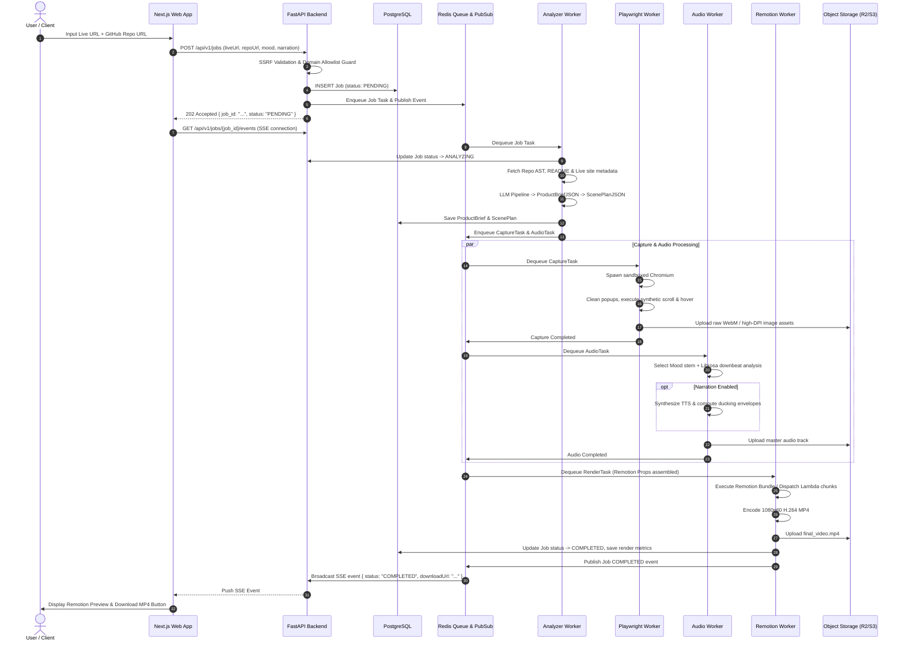

# 02. Architecture & Infrastructure

## 1. High-Level System Architecture Diagram

```
+---------------------------------------------------------------------------------------------------+
|                                        CLIENT TIER (Next.js 14)                                   |
|   +-----------------------+     +------------------------+     +------------------------------+   |
|   |  URL Submission Form  | --> | Job Progress / Status  | --> | Remotion Web Preview Player  |   |
|   | (Live URL + Repo URL) |     |  (SSE Stream Listener) |     |     & Direct MP4 Download    |   |
|   +-----------------------+     +------------------------+     +------------------------------+   |
+---------------------------------------------+-----------------------------------------------------+
                                              | HTTPS / JSON & Server-Sent Events (SSE)
                                              v
+---------------------------------------------------------------------------------------------------+
|                                      API GATEWAY (FastAPI / ASGI)                                 |
|  - Request Validation (Pydantic v2)         - Rate Limiting (Redis Token Bucket)                  |
|  - SSRF Verification Guard                  - Auth / API Key Verification                         |
|  - Job Lifecycle Orchestrator               - SSE Event Broadcaster                               |
+---------------------------------------------+-----------------------------------------------------+
                                              |
                                              v Redis PubSub (Real-time events)
+---------------------------------------------+-----------------------------------------------------+
|                                   DISTRIBUTED TASK BROKER (Redis 7)                               |
|   [Queue: high-priority]       [Queue: default-pipeline]       [Queue: rendering-cluster]         |
+---------------------------------------------+-----------------------------------------------------+
                                              |
                                              v Workers consume discrete step tasks
+---------------------------------------------------------------------------------------------------+
|                                      DISTRIBUTED WORKER CLUSTER                                   |
|                                                                                                   |
|  [ Worker 1: Analyzer & Director ]                                                                |
|  - GitHub API / Raw Sparse Crawler -> README, package.json, AST routes                            |
|  - Playwright Light Scrape -> Meta tags, OpenGraph, title, color palette                          |
|  - Claude 3.5 Sonnet / GPT-4o -> ProductBriefJSON -> Director LLM -> ScenePlanJSON               |
|                                                                                                   |
|  [ Worker 2: Headless Playwright Cinematographer ]                                                |
|  - Sandboxed Chromium container (SSRF-hardened network egress)                                     |
|  - Anti-modal script (purges cookie banners, popups, sticky widgets)                              |
|  - Synthetic Bezier cursor driver (smooth curves, decelerated hover, click waves)                 |
|  - High-DPI (2x DPR) full-page & element captures; 60fps CDP screen recording                      |
|                                                                                                   |
|  [ Worker 3: Audio & Beat Quantizer ]                                                             |
|  - Curated royalty-free stems library + Librosa spectral analysis (onset / beat timestamps)       |
|  - Dynamic duration quantizer: snaps scene lengths to musical downbeats (e.g., 2.0s, 3.2s)         |
|  - Optional ElevenLabs TTS voiceover synthesis + EBU R128 loudness normalization + auto-ducking   |
|                                                                                                   |
|  [ Worker 4: Remotion Composer & Renderer ]                                                       |
|  - Combines ScenePlanJSON, captured media, beat grid & audio stems into RemotionProps             |
|  - Headless Remotion Render Cluster (or AWS Lambda distributed dispatch)                          |
|  - Generates 1080p60 H.264 MP4 with hardware acceleration                                         |
+---------------------------------------------+-----------------------------------------------------+
                                              |
                                              v Upload artifact
+---------------------------------------------------------------------------------------------------+
|                                  OBJECT STORAGE & CDN (Cloudflare R2 / S3)                        |
|  - /raw-captures/{job_id}/*.webm               - /audio/{job_id}/*.mp3                            |
|  - /frames/{job_id}/*.png                      - /renders/{job_id}/final_launch_1080p60.mp4       |
+---------------------------------------------------------------------------------------------------+
```

---

## 2. Mermaid Pipeline Execution Sequence



---

## 3. Worker Topology & Network Isolation

```
                   [ Public Internet ]
                            |
                     [ Cloudflare WAF ]
                            |
                  +---------+---------+
                  |                   |
            [ Next.js Edge ]     [ FastAPI ALB ]
                                      |
                         +------------+------------+
                         |  Private VPC (No Ingress)|
                         |                         |
                         |  [ Redis 7 Cluster ]    |
                         |  [ PostgreSQL RDS ]     |
                         |                         |
                         |  [ Worker Nodes ]       |
                         |    - Analyzer (Egress)  |
                         |    - Playwright Sandbox | (Strict DNS Proxy / SSRF Firewall)
                         |    - Audio Librosa      |
                         |    - Remotion Render    |
                         +------------+------------+
                                      |
                          [ Cloudflare R2 / S3 ]
```

### Worker Responsibilities
1. **Analyzer Worker**: Low CPU, moderate network I/O, heavy outbound HTTPS to GitHub API, LLM API (Anthropic / OpenAI).
2. **Playwright Capture Worker**: High memory (Chromium instances), ephemeral network egress routed via an SSRF-filtering HTTP proxy. Auto-terminates browser contexts on timeout (max 45 seconds).
3. **Audio Worker**: High CPU burst for fast Librosa FFT spectral analysis, fast disk/RAM I/O for FFmpeg audio stitching and normalization.
4. **Remotion Render Worker**: Heavy CPU / GPU bound. Scale target is multi-threaded Chromium rasterization. For production burst capacity, dispatches to **Remotion Lambda** across 100+ concurrent micro-lambdas to render 1800 frames in parallel under 25 seconds.
